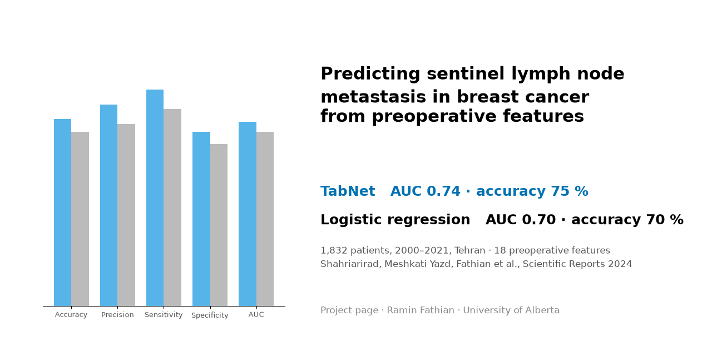
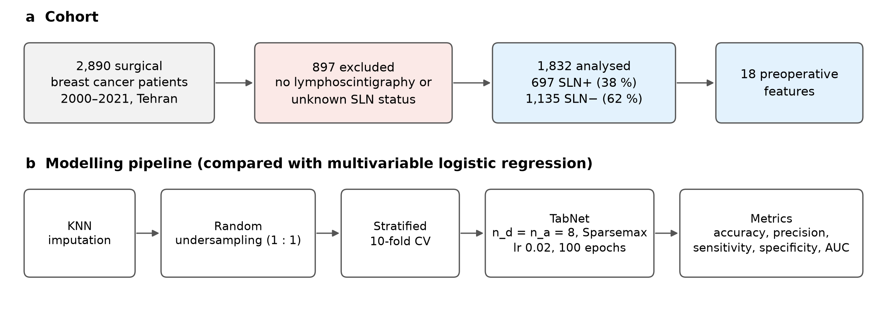
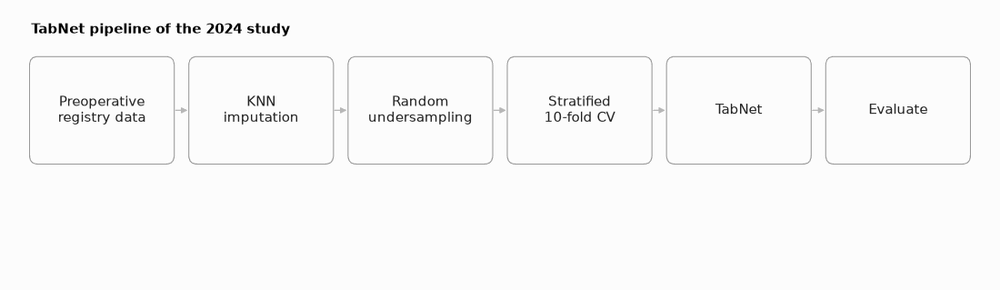
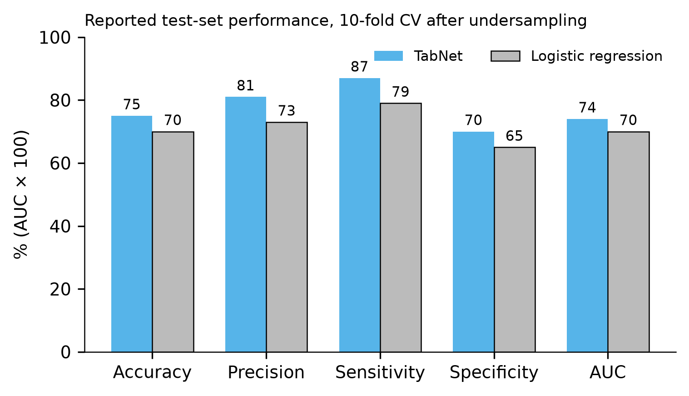

# Prediction of sentinel lymph node metastasis in breast cancer from preoperative features with TabNet

<p align="center"></p>

[](https://doi.org/10.1038/s41598-024-51244-y)
[](https://pubmed.ncbi.nlm.nih.gov/38228684/)


**Shahriarirad R, Meshkati Yazd SM, Fathian R, Fallahi M, Ghadiani Z, Nafissi N.** *Scientific Reports* 2024;14:1351. [doi:10.1038/s41598-024-51244-y](https://doi.org/10.1038/s41598-024-51244-y) · [PubMed 38228684](https://pubmed.ncbi.nlm.nih.gov/38228684/) · [PMC10791698](https://pmc.ncbi.nlm.nih.gov/articles/PMC10791698/) · open access (CC BY 4.0)

Project page maintained by **Ramin Fathian** (University of Alberta), who co-designed the study and developed the models. This repository is a results page for the paper: a summary, the reported numbers and figures. **It contains no patient data and no code.**

→ Follow-up study (2026), same cohort re-analysed with tabular foundation models: [Rfathian/sln-tabular-foundation-models](https://github.com/Rfathian/sln-tabular-foundation-models)

---

## Question

Sentinel lymph node biopsy (SLNB) is the standard way to stage the axilla in clinically node-negative breast cancer, but most sentinel nodes turn out to be free of disease. Could a model built on variables that are already known before surgery (demographics, reproductive history, receptor status, Ki67, core-needle biopsy pathology, tumour size, lymphovascular invasion) predict sentinel node involvement well enough to inform the decision? The paper applied TabNet, an attention-based deep learning architecture for tabular data, to a large surgical registry and compared it with multivariable logistic regression.

## Cohort

<p align="center"></p>

- Retrospective cohort of **2,890** surgical breast cancer patients treated between **2000 and 2021** at two referral hospitals of Iran University of Medical Sciences in Tehran (Rasoul Akram and Khatam Al-Anbia).
- **1,832** patients with a known sentinel node status were analysed; **697 (38 %)** had sentinel node metastasis.
- **18 preoperative features**: age, family history, number of children, age at first pregnancy, lactation, oral contraceptive use, abortions, ER, PR, HER2, Ki67, histology, core-needle biopsy result, multicentricity, lymphovascular invasion, laterality, tumour size, percentage of DCIS. Post-operative variables (pathological TNM, grade, nodal counts) were excluded.

## Method

<p align="center"></p>

1. Missing values imputed with k-nearest neighbours.
2. Majority class randomly undersampled to a 1 : 1 ratio.
3. Stratified 10-fold cross-validation.
4. **TabNet** (pytorch-tabnet): decision and attention width 8, feature re-use coefficient γ = 0.8, sparsity 4 × 10⁻⁴, batch-norm momentum 0.3, gradient clipping 2, Sparsemax masks, Adam with learning rate 0.02, batch size 256, 100 epochs, best epoch chosen on balanced accuracy.
5. Baseline: multivariable logistic regression on the variables with univariate p < 0.25.

## Results

<p align="center"></p>

| Metric | TabNet | Logistic regression |
|---|---|---|
| Accuracy | 75 % | 70 % |
| Precision | 81 % | 73 % |
| Sensitivity | 87 % | 79 % |
| Specificity | 70 % | 65 % |
| AUC | 0.74 | 0.70 |
| F1 | — | 73 % |

TabNet exceeded logistic regression on every reported metric. The features contributing most to the TabNet prediction were **lymphovascular invasion, tumour size, core-needle biopsy pathology, age and family history**; for logistic regression they were lymphovascular invasion, laterality, tumour size, age at first pregnancy and PR status. Lymphovascular invasion was the dominant predictor in both models, consistent with the nomogram literature.

Figure 1 of the paper (model comparison, TabNet feature importance, logistic regression coefficients) is open access on the [publisher's page](https://www.nature.com/articles/s41598-024-51244-y/figures/1).

## Why it mattered

- One of the largest single-registry SLN prediction cohorts from the Middle East, with two decades of follow-up data.
- An early application of an attention-based tabular deep learning model to a surgical decision problem, with feature attributions that matched clinical knowledge.
- 26 citations by November 2026.

## What the 2026 follow-up found

The same cohort was re-analysed with repeated cross-validation, temporal validation and transfer to METABRIC, comparing TabNet with tabular foundation models (TabPFN, TabICL), CatBoost and logistic regression. Under that protocol every model, including logistic regression, scored above the 0.74 reported here, and the undersampling step was shown to leave discrimination unchanged while distorting the predicted probabilities. The follow-up is the honest continuation of this work: see [sln-tabular-foundation-models](https://github.com/Rfathian/sln-tabular-foundation-models).

## Data and ethics

The dataset is available from the corresponding author of the paper on reasonable request and with permission of the Research Ethics Committee of Iran University of Medical Sciences. The study was approved by the ethics committees of Iran University of Medical Sciences and Tehran University of Medical Sciences, with consent waived for the retrospective design. No patient-level data are included in this repository.

## Citation

```bibtex
@article{Shahriarirad2024SLN,
  author  = {Shahriarirad, Reza and Meshkati Yazd, Seyed Mostafa and Fathian, Ramin and Fallahi, Mohammadmehdi and Ghadiani, Zahra and Nafissi, Nahid},
  title   = {Prediction of sentinel lymph node metastasis in breast cancer patients based on preoperative features: a deep learning approach},
  journal = {Scientific Reports},
  year    = {2024},
  volume  = {14},
  pages   = {1351},
  doi     = {10.1038/s41598-024-51244-y}
}
```

## License

The figures and text of this page are [CC BY 4.0](https://creativecommons.org/licenses/by/4.0/) (attribution: Ramin Fathian, link to this page). The paper itself is CC BY 4.0 (Shahriarirad et al. 2024).
